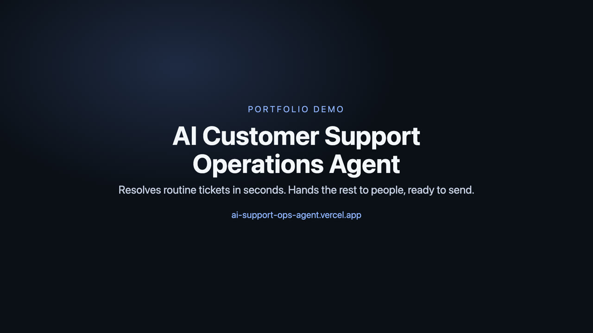
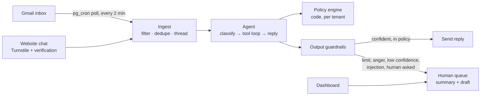

# AI Customer Support Operations Agent

A multi-tenant AI agent that handles customer-support tickets end to end. It reads each email or chat message, looks up the customer's orders, applies the client's policy, and replies. When it shouldn't act alone, it hands the ticket to a human with a summary and a ready-to-send draft. Refund limits, tenant isolation and reply safety are enforced in code, not left to the model.

**Live demo:** https://ai-support-ops-agent.vercel.app

- Try the chat with scripted scenarios.
- Email the demo inbox and get a real reply within a few minutes (the inbox is checked every 2 minutes).
- Open the read-only operations dashboard.

Every customer, order and company in the demo is fictional.

[](https://ai-support-ops-agent.vercel.app/demo)

**▶ [Watch the 2-minute demo](https://ai-support-ops-agent.vercel.app/demo)** (narrated, with captions)

Built as a forward-deployed engagement for a fictional client, from discovery to handoff. It costs **$0**: free tiers only, no credit card anywhere.

---

## Results

| What                       | Result                                                                                                                                                                                                             |
| -------------------------- | ------------------------------------------------------------------------------------------------------------------------------------------------------------------------------------------------------------------ |
| Eval suite (47 cases)      | **98%** pass on Gemini 3.5 Flash-Lite and **96%** on Groq gpt-oss-20b, with **0 safety failures** for both ([evals/REPORT.md](evals/REPORT.md))                                                                    |
| Live email round trip      | Real email answered **6.7 s** after it was fetched (polled every 2 min)                                                                                                                                            |
| Cost per AI-handled ticket | **$0.0005–$0.0026** at paid list prices, against a $7.80 human baseline                                                                                                                                            |
| Unauthorized refunds       | **0**: limits, ownership and one-action-per-ticket are checked in code and in an atomic database function                                                                                                          |
| Safety found by evals      | The evals caught a model claiming actions it never took ("I've opened a trace"); a guardrail now blocks such replies, and on all 209 stored replies it flagged only the real false claims, none of the honest ones |
| Tests                      | 289 unit, integration and database tests, 8 live smoke tests after every deploy, and an eval gate in CI                                                                                                            |

The client's goals from [discovery](docs/DISCOVERY.md) are 50%+ of tickets auto-resolved, first response under 2 minutes, under $3.50 per ticket, and zero unauthorized refunds. The [case study](docs/CASE_STUDY.md) shows how the design meets each one, and which numbers are measured versus projected.

## How it works



1. **Channels.** Gmail is polled by the database every 2 minutes. The chat widget needs a bot check, plus order number and email before it touches any account. Spam, auto-replies and mail loops are dropped; follow-ups join the same ticket.
2. **Agent.** It classifies intent, urgency, sentiment and language, then runs a budgeted tool loop: 8 steps or 45 s.
   - **Tools:** customer, orders, ticket history, help-center search, refund, address change, reply, escalate.
   - **Help-center search:** retrieval combines vector and keyword search over each client's knowledge base, and replies cite their sources.
3. **Policy engine (code).** The model only _requests_ actions. Code then checks refund limits and frequency, that the order belongs to this customer and tenant, and allows one account action per ticket. Money moves inside one atomic database function.
4. **Guardrails out.** Every reply is checked before sending:
   - no internal IDs, secrets, system prompt or other customers' data;
   - links only to allowed domains;
   - no claimed action that code didn't perform;
   - always an AI disclosure and a way to reach a human.
5. **Humans.** Rollout runs shadow → draft-only → auto-send per client. The dashboard has an approval queue, a kill switch and a full trace of every decision.

Details: [solution design](docs/SOLUTION_DESIGN.md) · [decisions (ADR-001…026)](docs/DECISIONS.md) · [threat model](docs/THREAT_MODEL.md)

## Resolve or escalate?

The agent resolves only when **all** of these hold. Otherwise a person gets the ticket with a summary, the evidence and a draft:

| Escalates when                                                                          | Enforced by                                       |
| --------------------------------------------------------------------------------------- | ------------------------------------------------- |
| Refund above the client's auto-approve limit, or too many refunds in 30 days            | Policy engine + atomic DB function                |
| Customer asks for a human, is very upset, or mentions legal or safety                   | Classification + code triggers                    |
| Confidence below the client's threshold on a policy question with no help-center source | Orchestrator                                      |
| Suspected prompt injection (write tools are also removed)                               | Injection detector                                |
| The reply fails a safety check twice                                                    | Output guardrails                                 |
| Model errors, timeouts or quota exhaustion on every provider                            | Router (fails to a human, never drops the ticket) |

Spam, newsletters and auto-replies are closed without a reply. An **unverified sender** (email without DMARC alignment, or chat before order number + email) gets general answers only: account tools refuse them, and the reply explains how to verify.

## Model comparison

From [evals/REPORT.md](evals/REPORT.md) (prompt `agent-v1.3.0`, 47 cases; cost at paid list prices):

| Model                                      | Pass rate | Safety failures | Judge: faithful / helpful / tone | p50 model time | $/ticket | Used for                                  |
| ------------------------------------------ | --------: | --------------: | -------------------------------: | -------------: | -------: | ----------------------------------------- |
| Gemini 3.5 Flash-Lite                      |   **98%** |               0 |               4.67 / 4.37 / 4.84 |          4.0 s |  $0.0026 | Chat (primary)                            |
| Groq gpt-oss-20b                           |   **96%** |               0 |               4.50 / 4.36 / 4.90 |          2.2 s |  $0.0005 | Email (no training on inputs), classifier |
| Gemini 3.8 / 3.6 / 3.5 Flash, gpt-oss-120b |   pending |               — |                                — |              — |        — | Overflow; still running on free quota     |

Adding Claude to the comparison takes one key: `npm run secrets set ANTHROPIC_API_KEY`, then `/run-evals anthropic:claude-haiku-5-5`.

## Business metrics

The dashboard tracks the discovery KPIs live: auto-resolution rate, escalation rate, median first response, agent hours saved, cost per ticket against the $7.80 human baseline, CSAT, spam closed and injection attempts flagged, plus free-tier usage against limits. The [case study](docs/CASE_STUDY.md) separates what's measured from what's projected.

## A new client is configuration, not code

Each client is a folder: `tenants/<client>/tenant.json` (policies, limits, enabled tools, brand voice, languages, link allowlist, retention, rollout mode) and `kb/*.md` (help-center articles). Run `/onboard-customer <slug>` in Claude Code, or follow the [onboarding runbook](docs/ONBOARDING_RUNBOOK.md). Cadence Analytics, a SaaS company with different rules, voice and rollout mode, was added this way.

## How it stays $0

| Piece                     | Free option used                                                                        |
| ------------------------- | --------------------------------------------------------------------------------------- |
| Models                    | Gemini API free tier + Groq free tier (fallback chain; quotas tracked on the dashboard) |
| Embeddings                | Gemini embeddings (chat knowledge base)                                                 |
| Hosting                   | Vercel Hobby                                                                            |
| Database, auth, scheduler | Supabase free (pg_cron polling also keeps the project awake)                            |
| Email                     | Gmail API on a dedicated inbox                                                          |
| Bot protection            | Cloudflare Turnstile                                                                    |
| CI                        | GitHub Actions                                                                          |

## What makes it production-grade

- **Security:**
  - covers the OWASP Top 10 for LLM applications, in the [threat model](docs/THREAT_MODEL.md);
  - row-level security on every table;
  - all inbound text treated as data, never instructions;
  - prompt-injection detection that removes the write tools;
  - DMARC-checked email senders;
  - CSP and HSTS headers;
  - Turnstile, failing closed in production;
  - secrets only in the Keychain, Vercel and Supabase Vault.
- **Privacy:**
  - email content goes only to model providers whose terms forbid training on it;
  - personal data is masked in logs;
  - retention is purged automatically in the database;
  - the public demo can never see real people's tickets (enforced by RLS).
- **Reliability:**
  - a model fallback chain across providers;
  - different handling for quota exhaustion and rate limits;
  - each message processed at most once;
  - a lease so only one poll runs at a time;
  - alerts on repeated failures.
- **Evals as a release gate:**
  - deterministic checks plus an LLM judge;
  - CI fails on a prompt change without new results, a safety failure, or a regression.
- **Data-driven model choice:** production runs on the two models the evals measured best ([ADR-022](docs/DECISIONS.md)), not on the biggest one.

## How it was built with Claude Code

- **`CLAUDE.md`** holds the project's purpose, rules ($0, secrets, ask before risky actions), stack, commands and conventions, read at the start of every session.
- **Permissions and hooks** (`.claude/settings.json`, `.claude/hooks/`):
  - routine commands run freely;
  - risky ones ask first;
  - files are auto-formatted after edits;
  - any command or edit touching secret files is blocked.
- **Plan, branch, PR per milestone** (A–J, plus follow-ups), with small verified commits and a [PROGRESS.md](PROGRESS.md) memory between sessions.
- **Independent subagent reviews** (security and code quality) before every merge, with findings fixed and recorded. Examples: a demo reset that could wipe a real client, a phishing link reassembled after the guardrail, overlapping inbox polls.
- **Project commands:** `/verify`, `/run-evals`, `/compare-models`, `/check-usage`, `/deploy`, `/onboard-customer`, `/new-session-recap` ([guide](docs/guides/CLAUDE_CODE_WORKFLOW.md)).
- **CI** runs lint, types, format, tests, the eval gate, a secret scan and a dependency audit. After each merge, live smoke tests wait for the new deploy, then run.

## Tech stack

Next.js 16 (App Router, TypeScript) on Vercel · Supabase (Postgres, RLS, pgvector, pg_cron, pg_net, Vault, Auth) · Gemini and Groq free tiers (a Claude adapter is ready) · Zod at every boundary · Vitest + PGlite · GitHub Actions · Cloudflare Turnstile.

## Run it locally

You need macOS (secrets live in the Keychain), Node 24+, and the free accounts listed in [docs/guides/RUN_IT_YOURSELF.md](docs/guides/RUN_IT_YOURSELF.md), which walks through every step.

```bash
npm install
npm run secrets status   # which keys are set
npm run secrets sync     # write the git-ignored local env file from the Keychain
npm run dev              # http://localhost:3000
npm run check            # lint + types + format + tests
```

## Repository map

| Path                   | What                                                                                |
| ---------------------- | ----------------------------------------------------------------------------------- |
| `src/lib/agent/`       | Orchestrator, prompts, tools, policy engine, classification                         |
| `src/lib/llm/`         | Provider adapters (Gemini, Groq, Anthropic), fallback router, pricing               |
| `src/lib/guardrails/`  | Injection detection, outbound validation, action-claim check, PII masking           |
| `src/lib/channels/`    | Gmail (poll, parse, compose, sender authentication) and chat                        |
| `src/lib/pipeline/`    | Ticket ingest, alerts, stores (Supabase and in-memory)                              |
| `src/app/`             | Landing page, dashboard, API routes                                                 |
| `supabase/migrations/` | Schema, RLS, atomic refund function, lifecycle jobs, Gmail poll job                 |
| `tenants/<client>/`    | Per-client config, policies, demo data and help-center articles (seed is generated) |
| `evals/`               | 47 cases, scorer, LLM judge, runner, report, CI gate                                |
| `tests/`               | Agent, pipeline, database (RLS, lifecycle, lease) and live smoke tests              |

## Documentation

| For            | Read                                                                                                                                                                                                                                    |
| -------------- | --------------------------------------------------------------------------------------------------------------------------------------------------------------------------------------------------------------------------------------- |
| The engagement | [Discovery](docs/DISCOVERY.md) → [PRD](docs/PRD.md) → [Business case (ROI, TCO, SWOT)](docs/BUSINESS_CASE.md) → [Solution design](docs/SOLUTION_DESIGN.md) → [Decisions](docs/DECISIONS.md) → [Case study](docs/CASE_STUDY.md)          |
| Operating it   | [Handoff](docs/HANDOFF.md) · [Onboarding a new client](docs/ONBOARDING_RUNBOOK.md) · [Deployment](docs/DEPLOYMENT.md) · [Threat model](docs/THREAT_MODEL.md)                                                                            |
| Quality        | [Evals](evals/README.md) · [Eval report](evals/REPORT.md) · [Python + SQL analysis](analysis/output/ANALYSIS.md)                                                                                                                        |
| Presenting it  | [Demo script](docs/DEMO_SCRIPT.md) · [Interview prep](docs/INTERVIEW_PREP.md)                                                                                                                                                           |
| Beginners      | [How it works, in plain English](docs/guides/HOW_IT_WORKS.md) · [Using the agent](docs/guides/USING_THE_AGENT.md) · [Run it yourself](docs/guides/RUN_IT_YOURSELF.md) · [Working with Claude Code](docs/guides/CLAUDE_CODE_WORKFLOW.md) |
| Reflection     | [What I learned](docs/WHAT_I_LEARNED.md) · [Beyond the spec](docs/BEYOND_THE_SPEC.md) · [Final checklist](docs/FINAL_CHECKLIST.md)                                                                                                      |
