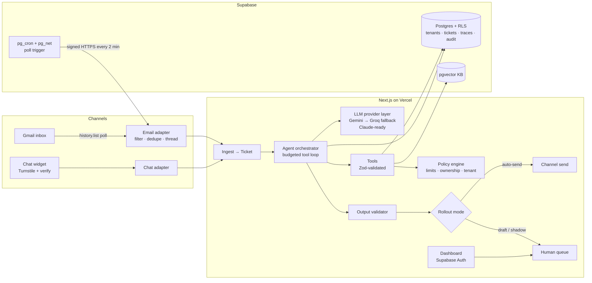

# Solution Design — AI Customer Support Operations Agent

_Client: Harbor & Pine Home Goods (fictional) · Second tenant: Cadence Analytics (fictional) · v1.0, 2026-11-03_

## 1. Summary

A multi-tenant support agent that turns each inbound email or chat message into a ticket, investigates it with narrowly scoped tools, resolves it within the tenant's policy, replies in the customer's language and brand voice, and escalates to a human with a ready-to-send draft when it shouldn't act alone. Business rules, tenant isolation and output safety are enforced in code; the model only proposes. It runs entirely on free tiers.

## 2. Architecture

**Components**

| Component          | Responsibility                                                                                                                                                                                                                                                                           |
| ------------------ | ---------------------------------------------------------------------------------------------------------------------------------------------------------------------------------------------------------------------------------------------------------------------------------------- |
| Channel adapters   | Normalize inbound messages (`InboundMessage`), filter spam/auto-replies/loops, dedupe by provider message ID, thread by `References`/`In-Reply-To` (email) or session (chat), send replies. Email + chat built; Zendesk/Slack/Intercom documented as adapters behind the same interface. |
| Ingest             | Create or continue a ticket, store the message, write an audit event, enqueue an agent run (idempotent).                                                                                                                                                                                 |
| Agent orchestrator | 1) Classify (intent, urgency, sentiment, language, spam, injection signal) → 2) tool loop to investigate and act → 3) draft reply → 4) decide resolve vs escalate. Max 8 steps, 60 s budget, structured outputs validated with Zod (retry once, then escalate).                          |
| LLM provider layer | One `LLMProvider` interface (chat + tool calls + JSON output + embeddings). Adapters: Gemini (primary), Groq (automatic fallback on 429/5xx/timeout), Anthropic (active only if `ANTHROPIC_API_KEY` is set). Selected by `LLM_PROVIDER` / `LLM_MODEL`.                                   |
| Tools              | `get_customer`, `get_orders`, `get_ticket_history`, `search_knowledge_base`, `issue_refund`, `update_order`, `send_reply`, `escalate_to_human`. Narrow Zod schemas; IDs, not free-form queries; always scoped to the ticket's tenant and verified customer.                              |
| Policy engine      | Pure TypeScript rules per tenant: refund auto-approve limit, max refunds per customer per 30 days, address change only before shipping, enabled tools, escalation triggers. Every write tool calls it; the model cannot bypass it.                                                       |
| Output validator   | Blocks replies containing system-prompt fragments, internal IDs/notes, other customers' data, secrets, or non-allowlisted links; enforces AI disclosure + human option.                                                                                                                  |
| Dashboard          | Ticket queue + filters, full trace view, escalation approve/edit/reject, tenant settings (rollout mode, limits, kill switch), business metrics, free-tier usage.                                                                                                                         |

## 3. Data flow (email)

1. **Trigger:** Supabase `pg_cron` calls `POST /api/channels/gmail/poll` every 2 minutes via `pg_net`, with an HMAC-signed header. A "Check now" button and the landing page "Send a demo email" flow also trigger it.
2. **Fetch:** `history.list` since the stored `historyId` → `messages.get` for new IDs.
3. **Filter:** drop own address, `no-reply`, `Auto-Submitted`, `List-Id`/`Precedence: bulk`, bounces; per-sender and per-thread reply caps.
4. **Dedupe:** insert into `processed_messages(provider, provider_message_id)` with a unique constraint; conflict = already handled.
5. **Ticket:** match the thread to an existing ticket or create one; resolve the sender to a customer **only** if the address matches and SPF/DKIM/DMARC pass (from `Authentication-Results`); otherwise "unverified" (read-only answers, no account actions).
6. **Agent run:** classification → tools → draft → validator → policy decision. Every model call, tool call, retrieved chunk, decision, latency and token count goes to `agent_traces`.
7. **Deliver:** according to the tenant rollout mode — shadow (store only), draft-only (human queue), auto-send (send + status `awaiting_customer` or `resolved`).
8. **Failure:** retries with exponential backoff (3×); then status `needs_attention` + alert email after repeated failures. Nothing is dropped.

Chat follows the same path from step 5, synchronously, with a verification step (order number + email) before account actions.

## 4. Model choice

| Role                       | Choice                                    | Why                                                                                    |
| -------------------------- | ----------------------------------------- | -------------------------------------------------------------------------------------- |
| Agent (chat)               | `gemini-3.5-flash-lite` (free tier)       | Measured: 98% of 47 eval cases, 0 safety failures, 4.0 s p50 (ADR-022).                |
| Agent (email) + classifier | Groq `openai/gpt-oss-20b`                 | Measured: 96%, 0 safety failures, 2.2 s p50; no training on inputs (ADR-020).          |
| Overflow                   | Gemini 3.8 / 3.6 Flash, Groq gpt-oss-120b | Used when the primaries hit free-tier limits; still being measured.                    |
| Embeddings                 | `gemini-embedding-2` @ 768 dims           | Free, multilingual, 768 dims fits pgvector efficiently.                                |
| Claude (inactive)          | `claude-sonnet-5-5` / `claude-haiku-5-5`  | Adapter ready; enabled by one env var; included in model comparison if a key is added. |

The original hypothesis (Gemini 3.8 Flash primary) was replaced **with data** from the eval suite (milestone I, `evals/REPORT.md`, ADR-022): quality, policy compliance, latency, and estimated cost per ticket. Facts: `docs/research/FREE_TIER_RESEARCH.md`.

## 5. Security approach (summary — full detail in THREAT_MODEL.md)

- **Prompt injection (LLM01):** inbound text goes only in a delimited `untrusted_customer_message` block; the system prompt states it is data. A heuristic + model-signal detector flags attempts; flagged tickets lose write tools and go to review.
- **Excessive agency (LLM06):** least-privilege tools, per-tenant enabled tools, and policy-engine approval for every write. Refunds above the limit → escalation.
- **Sensitive disclosure (LLM02/LLM07):** output validator; PII masked in logs; system prompt never echoed.
- **Tenant isolation:** `tenant_id` on every row; RLS on every table; dashboard users see only their tenant's data; server code always passes tenant scope explicitly.
- **App security:** Supabase Auth for the dashboard, security headers + CSP, CSRF protection on mutations, Zod on every endpoint, signed webhook/cron calls, Turnstile on chat, rate limits + daily caps + kill switch, gitleaks + npm audit in CI.

## 6. Free-tier design ($0)

| Concern                          | Choice                                                                           | Trade-off                                                                                                                                                                        |
| -------------------------------- | -------------------------------------------------------------------------------- | -------------------------------------------------------------------------------------------------------------------------------------------------------------------------------- |
| New-email detection              | Poll Gmail via Supabase `pg_cron` every 2 min                                    | Gmail push needs Pub/Sub with a billing account (card). Vercel Hobby cron runs only once a day. Polling adds ≤ 2 min latency; that's fine against a 9.5 h baseline.              |
| Gmail OAuth token lifetime       | Publish the OAuth app (unverified, single user) instead of "Testing"             | Testing-mode refresh tokens expire after 7 days. An unverified production app shows a warning screen once to our own account and keeps tokens. Fallback: re-auth button + alert. |
| Supabase pause after 7 idle days | The 2-min poll hits the database constantly; plus a daily Vercel cron keep-alive | —                                                                                                                                                                                |
| Model rate limits                | Groq fallback, per-tenant daily caps, usage meter with warnings at 80%           | Peak bursts queue instead of failing.                                                                                                                                            |

## 7. Rollout plan

| Phase                    | Mode                                                                       | Exit criteria                                                                        |
| ------------------------ | -------------------------------------------------------------------------- | ------------------------------------------------------------------------------------ |
| 0. Offline               | Eval suite only                                                            | ≥ 90% resolve-vs-escalate correctness; 100% policy compliance; 0 injection successes |
| 1. Shadow (week 1–2)     | Agent drafts, nothing sent                                                 | Human agreement with drafts ≥ 85% on a 100-ticket sample                             |
| 2. Draft-only (week 3–4) | Human approves every reply                                                 | ≥ 80% approved without edits; no policy violations                                   |
| 3. Auto-send (week 5+)   | Auto-send for low-risk intents (WISMO, KB answers); draft-only for refunds | KPIs in DISCOVERY.md trending to target; weekly review of escalations                |

Rollback at any phase = flip the tenant's rollout mode or the kill switch in the dashboard (takes effect immediately, no deploy).

## 8. Multi-tenancy and onboarding

Each tenant's behaviour is data: `tenant_settings` (rollout mode, refund limits, escalation thresholds, enabled tools, brand voice, languages, allowed link domains) + its own knowledge base + its own channel config. Onboarding a client = run `/onboard-customer` (creates the tenant, settings, KB ingestion, seeds test cases) — no code changes. See `ONBOARDING_RUNBOOK.md`.
